<!-- Warm Espresso & Butter-Cookie Editorial GitHub Profile -->

  

  
  &nbsp;&nbsp;
  
  &nbsp;&nbsp;
  

  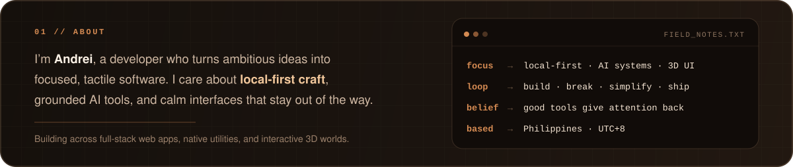

  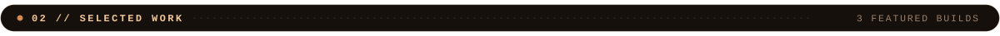

  <a href="https://github.com/butterkookies/FinLITE">
    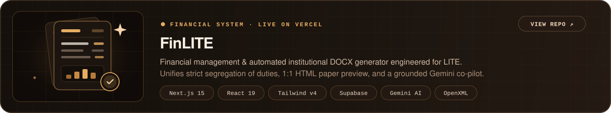
  </a>

  <a href="https://github.com/butterkookies/oceanica">
    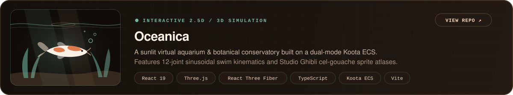
  </a>

  <a href="https://github.com/butterkookies/life-hub-assistant">
    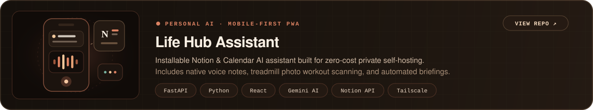
  </a>

  
  &nbsp;&nbsp;
  

  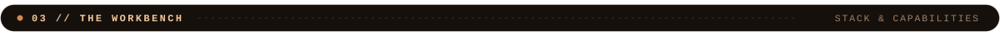

  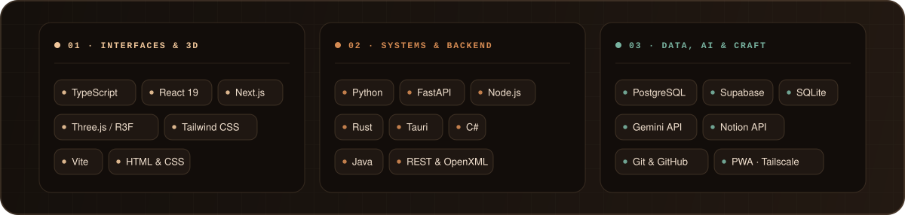

  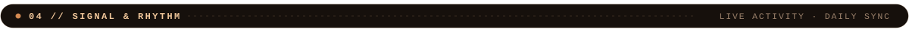

<!-- Auto-published daily to the output branch by .github/workflows/snake.yml -->

  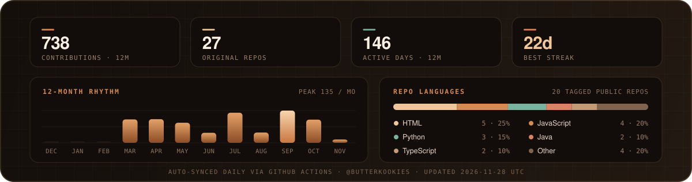

  <picture>
    <source media="(prefers-color-scheme: dark)" srcset="https://raw.githubusercontent.com/butterkookies/butterkookies/output/github-contribution-grid-snake-dark.svg" />
    <source media="(prefers-color-scheme: light)" srcset="https://raw.githubusercontent.com/butterkookies/butterkookies/output/github-contribution-grid-snake.svg" />
    
  </picture>

  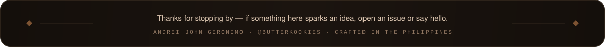

