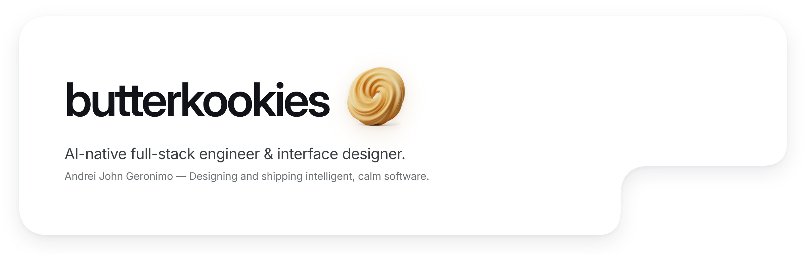

  

  <a href="https://github.com/butterkookies?tab=repositories"><strong>Repositories</strong></a>
  &nbsp;&nbsp;&nbsp;&nbsp;
  <a href="https://www.linkedin.com/in/geronimo-andrei-john-p-931472413/"><strong>LinkedIn</strong></a>
  &nbsp;&nbsp;&nbsp;&nbsp;
  <a href="https://fin-lite-six.vercel.app"><strong>FinLITE Live ↗</strong></a>

 

I'm **Andrei John Geronimo**, an AI-native full-stack engineer and interface designer based in the Philippines. I bridge product design, systems engineering, and applied AI to build local-first tools, grounded workflows, and calm interactive software.

 

### Selected Work

<strong>FinLITE</strong> — Financial management &amp; automated institutional DOCX engine

 

Web-based financial system built for the League of Information Technology Enthusiasts (LITE), pairing strict segregation of duties (Treasurer, Auditor, Adviser) with an interactive 1:1 HTML paper preview, OpenXML `.docx` compilation, and a deterministically grounded Gemini co-pilot.

**Stack:** Next.js 15, React 19, Tailwind CSS v4, Supabase (PostgreSQL & RLS), Gemini API, OpenXML  
**Links:** [Repository](https://github.com/butterkookies/FinLITE) &nbsp;&nbsp; [Live Application ↗](https://fin-lite-six.vercel.app)

 

<strong>Oceanica</strong> — Sunlit 2.5D / 3D virtual aquarium &amp; botanical conservatory

 

Customizable virtual aquarium simulation engineered around a dual-mode Koota ECS (`sandbox` and `realistic` ecosystem rules), 12-joint sinusoidal swim kinematics, biological species modeling, and hand-crafted Studio Ghibli cel-gouache dynamic sprite atlases.

**Stack:** React 19, Three.js, React Three Fiber, TypeScript, Koota ECS, Tailwind CSS, Vite  
**Links:** [Repository](https://github.com/butterkookies/oceanica)

 

<strong>Life Hub Assistant</strong> — Mobile-first personal AI PWA for Notion &amp; Calendar

 

Installable progressive web app connecting Notion Workspace and Calendar with Gemini AI — featuring native in-app voice notes, treadmill display photo workout scanning, automated morning briefings, Web Push (VAPID), and zero-cost private HTTPS deployment over Tailscale.

**Stack:** FastAPI, Python, React, Google Gemini, Notion API, PostgreSQL / SQLite, Tailscale  
**Links:** [Repository](https://github.com/butterkookies/life-hub-assistant)

 

### Stack

<strong>Interface, Full-Stack &amp; AI Capabilities</strong>

 

**Design & Frontend** — TypeScript, React 19, Next.js, Tailwind CSS, Three.js / React Three Fiber, Vite  
**Backend & Systems** — Python, FastAPI, Node.js, Rust, Tauri, C#, Java, OpenXML  
**AI & Data** — Google Gemini API, Grounded AI Workflows, PostgreSQL, Supabase, SQLite, Notion API, PWA

