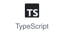

  

  <a href="https://github.com/butterkookies?tab=repositories"><strong>Repositories</strong></a>
  &nbsp;&nbsp;&nbsp;&nbsp;
  <a href="https://www.linkedin.com/in/geronimo-andrei-john-p-931472413/"><strong>LinkedIn</strong></a>

 

I'm **Andrei John Geronimo**, an AI-native full-stack engineer and interface designer based in the Philippines. I am currently a **3rd-year Bachelor of Science in Information Technology (BSIT)** student at **Pambayang Dalubhasaan ng Marilao**, focusing on web systems, systems integration and architecture, and database engineering.

Outside coursework, I bridge product design, full-stack engineering, and applied AI to build local-first tools, grounded AI workflows, and calm, tactile software.

 

### Stack

**Design & Frontend**

  <picture><source media="(prefers-color-scheme: dark)" srcset="assets/icons/typescript-dark.svg" /></picture><picture><source media="(prefers-color-scheme: dark)" srcset="assets/icons/react-dark.svg" /></picture><picture><source media="(prefers-color-scheme: dark)" srcset="assets/icons/nextdotjs-dark.svg" /></picture><picture><source media="(prefers-color-scheme: dark)" srcset="assets/icons/tailwindcss-dark.svg" /></picture><picture><source media="(prefers-color-scheme: dark)" srcset="assets/icons/threedotjs-dark.svg" /></picture><picture><source media="(prefers-color-scheme: dark)" srcset="assets/icons/vite-dark.svg" /></picture>

**Backend & Systems**

  <picture><source media="(prefers-color-scheme: dark)" srcset="assets/icons/python-dark.svg" /></picture><picture><source media="(prefers-color-scheme: dark)" srcset="assets/icons/fastapi-dark.svg" /></picture><picture><source media="(prefers-color-scheme: dark)" srcset="assets/icons/nodedotjs-dark.svg" /></picture><picture><source media="(prefers-color-scheme: dark)" srcset="assets/icons/rust-dark.svg" /></picture><picture><source media="(prefers-color-scheme: dark)" srcset="assets/icons/tauri-dark.svg" /></picture><picture><source media="(prefers-color-scheme: dark)" srcset="assets/icons/dotnet-dark.svg" /></picture><picture><source media="(prefers-color-scheme: dark)" srcset="assets/icons/openjdk-dark.svg" /></picture>

**AI, Data & Tooling**

  <picture><source media="(prefers-color-scheme: dark)" srcset="assets/icons/googlegemini-dark.svg" /></picture><picture><source media="(prefers-color-scheme: dark)" srcset="assets/icons/postgresql-dark.svg" /></picture><picture><source media="(prefers-color-scheme: dark)" srcset="assets/icons/supabase-dark.svg" /></picture><picture><source media="(prefers-color-scheme: dark)" srcset="assets/icons/sqlite-dark.svg" /></picture><picture><source media="(prefers-color-scheme: dark)" srcset="assets/icons/notion-dark.svg" /></picture><picture><source media="(prefers-color-scheme: dark)" srcset="assets/icons/git-dark.svg" /></picture>

